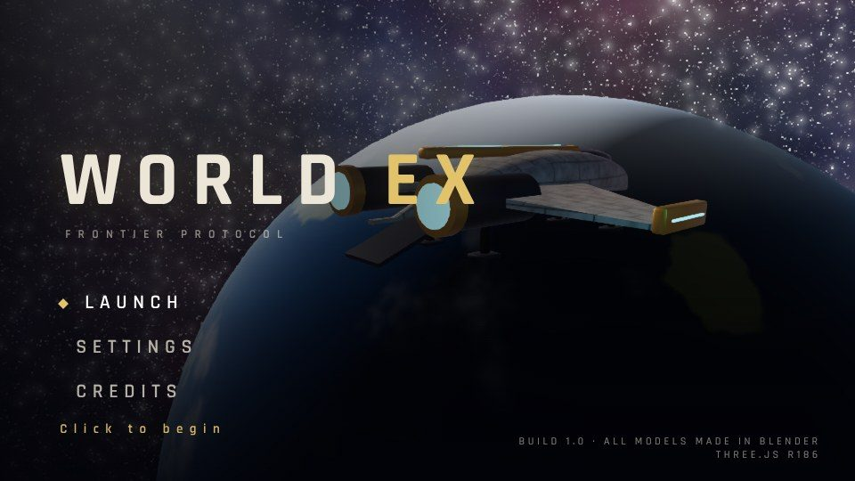
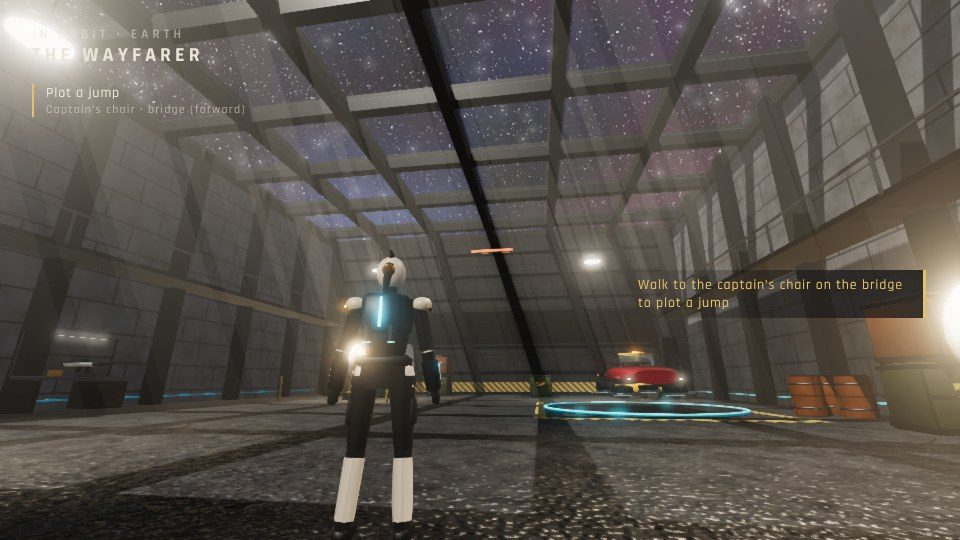
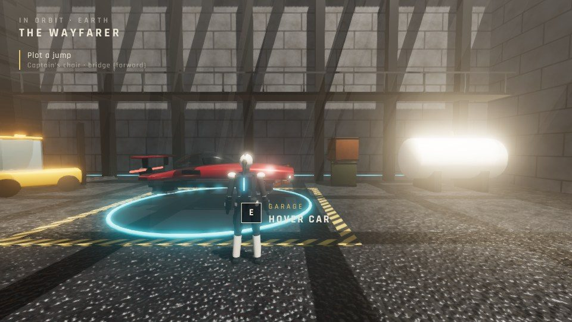
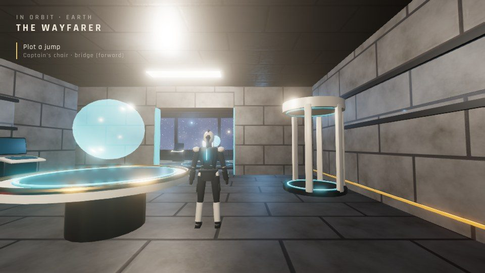
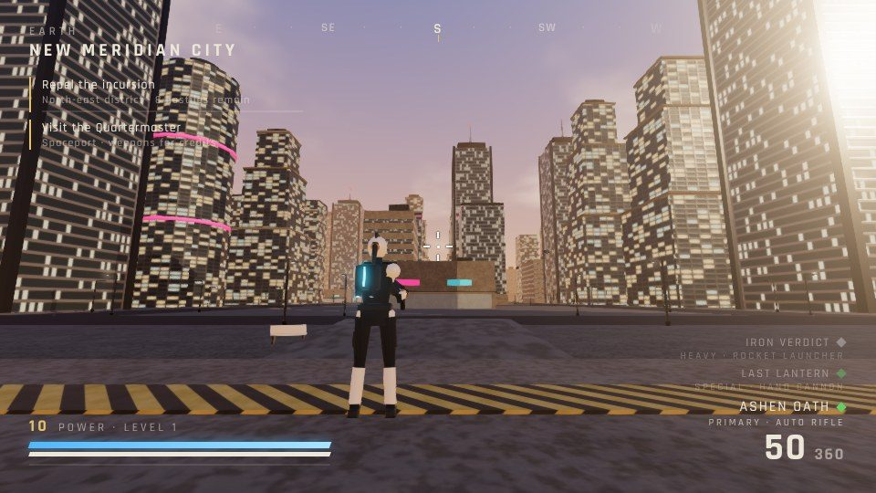
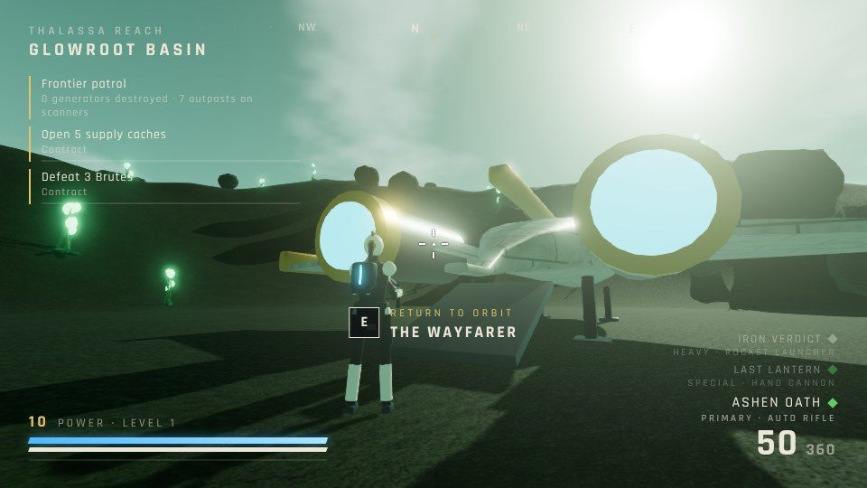

# WORLD EX — Frontier Protocol

A first-person sci-fi looter shooter in the browser (with an optional third-person view) (Three.js r186). You live aboard your own ship, the **Wayfarer**.
Walk its decks to reach every system that used to sit in the main menu, then jump to **Earth**, a city hub,
or to one of five **frontier worlds** whose terrain is generated endlessly in every direction.

Every 3D model (the female and male player characters, the civilians, enemies, guns, hover cars, ships, buildings, machines,
props, pickups) and every texture is made by Python scripts run in headless Blender (`tools/blender/`).
Every sound is synthesised live with WebAudio.

| | |
|---|---|
|  |  |
|  |  |
|  |  |

*(Captured with headless software rendering at the High preset.)*

## Run it
```bash
python3 -m http.server 8765        # then open http://localhost:8765/
```
Everything is local (three.js is vendored in `lib/`), so it runs offline. The fonts fall back to system fonts if Google Fonts is unreachable.

## Controls
| Key | Action |
|---|---|
| W A S D | Walk (drive in a car) |
| Shift | Run (boost in a car) |
| Mouse | Look / aim |
| T | Switch between first person (default) and third person (the third-person camera never clips through walls) |
| Space | Jump (handbrake in a car) |
| E | Interact: stations, caches, enter/exit cars, return to orbit |
| Left / Right mouse | Fire / aim down sights |
| R | Reload |
| 1 2 3 / wheel | Switch weapon (Primary, Special, Heavy) |
| V | Summon your hover car (Earth and planets) |
| Esc | Pause / leave a station |
| F3 | FPS counter |

## Phones (iPhone)
Open the game in Safari and turn the phone sideways. Use **Share → Add to Home Screen** to play full screen.
| Control | Action |
|---|---|
| Left side | Floating stick: move. Push it to the top edge, or tap the bolt button, to sprint |
| Right side | Drag to look. You can drag while holding the fire button |
| Large amber button | Fire |
| Corner-brackets button | Aim down sights (toggle) |
| Arrow button | Jump (handbrake in a car) |
| **E** button | Interact: glows when something is in reach; also enter and exit cars |
| Top-right row | Switch weapon, summon car, first/third person, pause |
In a car the stick steers and accelerates and the bolt button boosts. Every station panel has a **Leave station** button.
If there is no sound, check the phone's silent switch.

## The ship (replaces the main menu)
| Old menu screen | Where it lives now |
|---|---|
| Play / Teleport / World map | **Captain's chair** on the bridge: navigation to Earth and the frontier worlds |
| Home / Help / About | **Briefing table** in the commons: contracts (bounties), field guide, controls |
| Character | **Wardrobe pod**: female or male frame, armour and light colours (drag to turn) |
| Settings / Controls | **Engineering terminal**: graphics presets, render scale, 60 fps governor, FOV, audio, sensitivity |
| Stats | **Service record** console |
| Arsenal | **Armory rack** in the hangar: loadout by slot, with weapon stats and perks |
| Gunsmith | **Gunsmith bench**: infuse power, dismantle for alloy, weapon shaders |
| Vehicles | **Hover car** on the hangar pad: chassis and paint |

The hangar has big skylights casting sun shafts and shadows, a welding robot throwing sparks that bloom,
and a hover car whose clear-coat paint reflects the hangar (its environment map is captured from the scene).

## Worlds
* **Earth: New Meridian** is a free-roam island about 2.8 km across, with no missions. It has the city in the middle (instanced towers, parks, skyway traffic, the spaceport with your jumpship and the Quartermaster), the villages of Harrow, Millbrook and Eastwell, four farms with barns, silos, crops and fences, forests, a wind farm on the hills, a lake and the bay all around. Highways join everything together.
  Pedestrians fill the sidewalks, village lanes and farmyards, and hover-car traffic follows the roads. You can shoot civilians, run them over, or hijack any car (press **E** at a car in traffic and the driver bails out). Crimes raise a **wanted level** (up to five stars), and city security drones hunt you until you lie low. A rotating minimap shows where you are.
* **Frontier worlds:** Ares Verge, Vesper, Thalassa Reach, Pyrrhos and Nyx Expanse. Terrain streams in 64 m chunks seeded by
  (planet, chunk), so it is endless but stable. Each world has its own palette, sky, flora, hazards (lava on Pyrrhos), raider outposts
  (generator, turret, squad, a locked cache), roaming drones and loose supply caches. Rewards grow with distance from the landing zone.

## Player characters
The female and male characters are rebuilt from the owner's reference art in `art/reference/`. The face plates are projected from those photos and calibrated to the sculpted heads. Fabric and armour swatches are cut from the same images. Hair uses alpha-tested strand cards. The wardrobe pod switches frame, outfit and hair style, and tints the materials ("original" keeps the reference colours):
* Female: Circuit Coat, Circuit Crop, White Knit, Off Duty; high ponytail or long straight hair.
* Male: Vanguard Plate, Ranger Armour, Field Jacket.

## Loot
Weapons: auto rifle, pulse rifle, scout rifle, hand cannon, shotgun, sniper and rocket launcher. Rarity runs Common, Uncommon, Rare,
Legendary, Exotic, with random perks and stat rolls. Enemies drop data cores (coloured by rarity, with a light beam for Rare and up),
ammo and credits. Power = the average of your equipped weapons. Progress saves to `localStorage`.

## Layout
| Path | What it is |
|---|---|
| `index.html` | Game page |
| `src/main.js` | Boot, title, loading, travel, stations, loop, progression |
| `src/core/` | Renderer + post FX (bloom, FXAA, dynamic resolution), input, procedural audio, asset loader, collision world |
| `src/game/` | Player controller and camera, avatar, weapons, combat, enemies, vehicles, FX, data, save state |
| `src/worlds/` | Ship hub, Earth city, procedural planets, skies |
| `src/ui/` | HUD, menus/station panels, CSS |
| `tools/blender/` | Headless Blender scripts that build every model and texture (`build_all.sh`) |
| `assets/models`, `assets/textures` | Generated GLBs, layout JSON and baked textures |
| `lib/` | Vendored three.js + three-mesh-bvh |
| `tools/test/e2e.js` | Playwright end-to-end test (title → ship stations → Earth combat and car → planet streaming → ship) |
| `tools/test/meridian.js`, `mobile.js` | Free-roam Earth test, iPhone touch test |
| `tools/test/charview.html` | three.js character viewer (`?m=player_female&o=knit&h=ponytail&v=face`) |
| `art/reference/` | The owner's character reference images used by `tools/blender/refs.py` |
| `legacy/` | The previous single-file engine, kept for reference (still builds with `legacy/tools/build.py`) |

## Rebuild the assets
```bash
pip install bpy            # Blender as a Python module (or use a Blender install)
bash tools/blender/build_all.sh
```
The scripts are run as `blender --background --python tools/blender/<script>.py`. `tools/blender/preview.py` renders contact sheets with Cycles to check models.

## Test
```bash
python3 -m http.server 8765 &
NODE_PATH=$(npm root -g) node tools/test/e2e.js     # screenshots in test-out/
```
